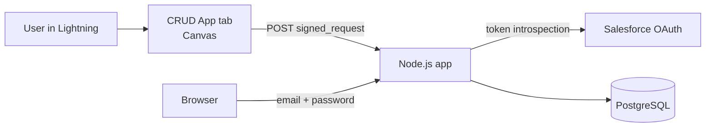

# node-crud-sso

Customer and user management (CRUD) in Node.js + PostgreSQL that runs inside Salesforce as a tab, with automatic sign-in.

- **Automatic SSO from Salesforce:** the app opens in the **CRUD App** tab (Canvas, Signed Request POST through the External Client App `NodeCrudEca`). Users with the `NodeCrud_Access` permission set who are linked in the app by their Salesforce User Id sign in with no login screen.
- **Email + password** for everyone else: argon2id hashes, account lockout and rate limiting.
- **Public homepage only:** every other route requires a session.



Full component and sequence diagrams are in [docs/architecture.md](docs/architecture.md).

## Prerequisites

- Node.js 22 or newer, Docker, Salesforce CLI 2.155 or newer, `jq`, `curl`, `mkcert`, `cloudflared` (for development)
- A Salesforce org with My Domain and External Client Apps (Metadata API 66.0 or newer, for ECA Canvas), and an admin user

Details are in [docs/salesforce-setup.md](docs/salesforce-setup.md#prerequisites).

## Quick start

```bash
npm install
docker compose up -d db db-test
mkcert -install && mkdir -p certs && mkcert -cert-file certs/localhost.pem -key-file certs/localhost-key.pem localhost 127.0.0.1

sf org login web --alias <alias>
(cd salesforce && sf config set target-org <alias> \
  && sf project deploy start --source-dir force-app --dry-run \
  && sf project deploy start --source-dir force-app)
sf org assign permset --name NodeCrud_Access --target-org <alias>

npm run init-env        # .env from the org: ids, origins, session secret, ECA key/secret
npm run migrate
npm run create-admin -- --email you@example.com --name "Your Name"
npm run dev:tunnel      # public HTTPS URL + Canvas URL deploy + app
```

Then sign in at `<tunnel-url>/auth/login`, set your **Salesforce User Id** in **Users → Edit**, and open the **CRUD App** tab in Lightning.

## Documentation

| Document | Contents |
|---|---|
| [docs/architecture.md](docs/architecture.md) | Components, sequence diagrams, request pipeline, data model, repository layout |
| [docs/salesforce-setup.md](docs/salesforce-setup.md) | Prerequisites and step-by-step setup in any Salesforce org |
| [docs/configuration.md](docs/configuration.md) | Environment variables and npm scripts |
| [docs/operations.md](docs/operations.md) | Development tunnel, credential rotation, logs, account administration, deploys |
| [docs/security.md](docs/security.md) | Canvas SSO checks, sessions, local accounts, hardening, monitoring, residual risks |
| [docs/troubleshooting.md](docs/troubleshooting.md) | `auth.canvas.rejected` reasons, deploy errors, local issues |

## Development

```bash
npm test        # Vitest + Supertest against Postgres (docker compose up -d db-test)
npm run lint    # ESLint + EJS escaping check
```

Tech stack: Express 5, EJS, PostgreSQL 16 (`pg`, `node-pg-migrate`, `connect-pg-simple`), argon2, zod, helmet, csrf-sync, Pino, Vitest.
