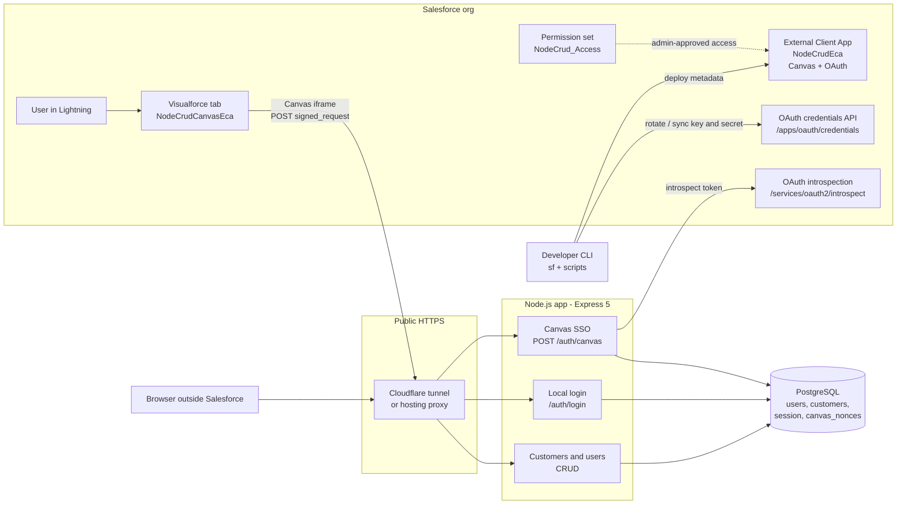
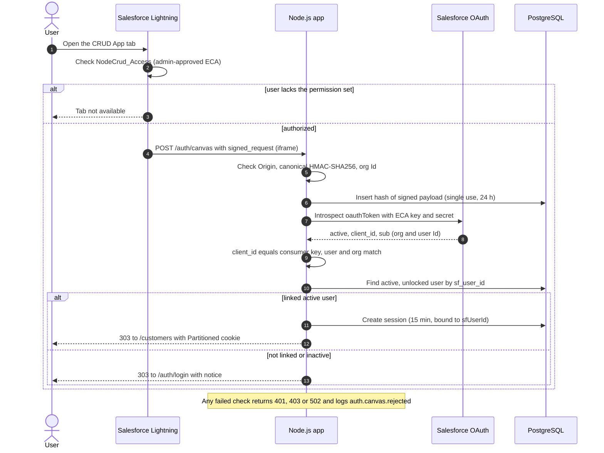
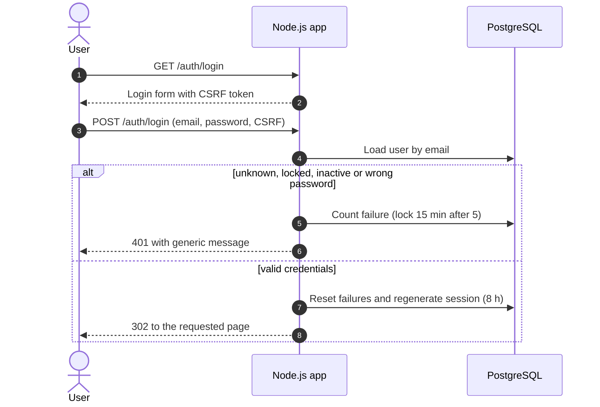

# Architecture

## Overview

The app is a server-rendered Express 5 application backed by PostgreSQL. It has a public homepage; every other route requires a session. Users sign in in one of two ways:

| Strategy | Entry point | Who |
|---|---|---|
| Email + password | `GET/POST /auth/login` | Any active local user |
| Automatic SSO (Salesforce Canvas) | `POST /auth/canvas` | Salesforce users with the `NodeCrud_Access` permission set **and** a local user linked by Salesforce User Id |

Both strategies end in the same place, `establishSession()`. It regenerates the session id and rotates the CSRF token.

## Components



| Component | Responsibility |
|---|---|
| `NodeCrudEca` (External Client App) | Canvas app, with access method Signed Request (POST) and the Visualforce location. OAuth scope `openid`. Policy: admin-approved users, pre-authorized through `NodeCrud_Access`. |
| `NodeCrudCanvasEca` (VF page + tab "CRUD App") | Hosts `<apex:canvasApp developerName="NodeCrudEca">` inside Lightning. |
| `NodeCrud_Access` (permission set) | The only way a Salesforce user gets SSO. It also grants access to the VF page and tab. |
| Express app (`src/`) | Security headers (CSP `frame-ancestors`), Pino logging, sessions in Postgres, CSRF, local and Canvas auth, CRUD. |
| PostgreSQL | `users` (with `sf_user_id`, lockout columns), `customers`, `session` (connect-pg-simple), `canvas_nonces` (replay protection). Runtime role `app_runtime` has DML only; migrations run as `app_migrator`. |
| Cloudflare tunnel / hosting | Public HTTPS origin. The Canvas iframe cannot reach `localhost`, because Chrome's Local Network Access blocks it. |

## Canvas SSO sequence



## Local login sequence



## Request pipeline

Middleware runs in this order (`src/app.js`): security headers → HTTP logger → static assets → `/healthz` → body parser (64 kb) → session → `loadCurrentUser` → `requireAuth` (global, with a public-path allowlist: `/`, `/healthz`, `/auth/*`, `/assets/*`) → CSRF (every POST except `/auth/canvas`) → method override → routes.

`loadCurrentUser` re-reads the user on every request. It revokes the session when the user is deleted, inactive or locked, and when a Canvas session is older than 15 minutes or its `sfUserId` no longer matches `users.sf_user_id`.

## User interface inside Salesforce

When the session comes from Canvas (`authMethod === 'canvas'`), or the page is opened with `?embedded=1`, the app hides its own header: brand, navigation and **Sign out**. Lightning already provides those around the tab, so the app reads as part of Salesforce. This is in `src/views/partials/head.ejs`.

As a result, the **CRUD App** tab shows only the customer screens. User administration (**Users**) and logout are available only when the app is opened directly in a browser (`<app-url>/auth/login`, local sign-in). Canvas sessions don't need a logout: they end after 15 minutes, or when the Salesforce link is removed.

## Data model

| Table | Key columns |
|---|---|
| `users` | `email` (citext, unique), `password_hash` (argon2id), `role` (`admin`/`user`), `active`, `sf_user_id` (18-char, unique, nullable), `failed_login_count`, `locked_until` |
| `customers` | `name`, `document` (CPF/CNPJ digits, unique), `email`, `phone`, `created_by` |
| `session` | connect-pg-simple store |
| `canvas_nonces` | `hash` (SHA-256 of the signed payload), `expires_at` |

The only link between a Salesforce user and a local user is `users.sf_user_id`. Admins set it in the user form. Email is never used for linking, and users are never created automatically from Salesforce.

## Repository layout

```
src/                     Express app (auth/, users/, customers/, security/, views/)
migrations/              node-pg-migrate migrations
test/                    Vitest + Supertest (real Postgres on port 55433)
salesforce/              SFDX project: ECA, VF page, tab, permission set
scripts/                 init-env, dev-tunnel, set-app-url, rotate-eca-credentials and helpers
docker/initdb/           Local database roles (app_migrator, app_runtime)
docs/                    This documentation
```
